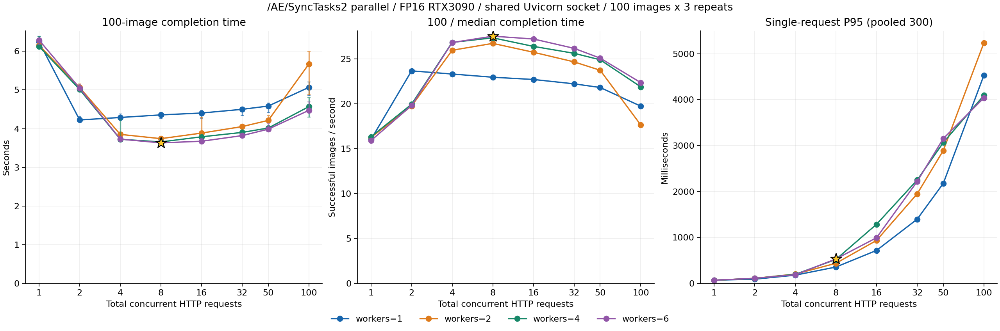
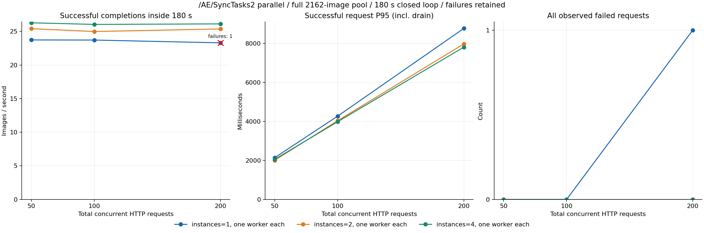

# SyncTasks2并行版TRT全面复测报告

本轮96组固定100图全部结束，共9600次请求、0次失败。所测网格最快零失败点为 **workers=6、总并发=8**，100图中位 **3.632秒**、27.54图/秒；三轮范围3.573～3.700秒。最快点5%内、优先较少worker再较低并发的资源取舍为 **W2/C8**，3.741秒、26.73图/秒。只适用于本轮固定100输入/连接方式/有限窗口，不是全局服务硬峰值、长期容量或混合接口验收。

## 版本、条件与覆盖

测量提交 `9b2884997bd9dd0c6b83d6b4e75e99d9f1aa24d7`，业务实现 `f549db037c0592eec324b995c8d16ddb6fd541dc`。只有SyncTasks2的同ROI人数/人脸模型线程并行，多ROI顺序、阈值/NMS/响应及四件FP16 Engine不变。仅指定物理GPU1 RTX3090（UUID GPU-8c6b7efd-2b4f-04f3-db71-b50d2482fc49），vbas-trt环境，batch1。Engine manifest SHA `0af5bc09e65fc318fcdb7a2b66263522091b79f66d1bbe32892bb0fc53517360`；数据/配置/四Engine/脚本逐项SHA见summary和私有plan，不将完整配置、照片或模型入Git。

- 固定100：同一100个不同ID及payload，W1/2/4/6×C1/2/4/8/16/32/50/100×3轮，升序/降序/seed20261118乱序。单main:app共享socket，每组新HTTPX、连接上限=C，HTTP60秒、无重试；至少30秒短连接预热且各worker均覆盖。
- 压力：完整2162图池、seed20261118，I1/2/4且每实例1worker，C50/100/200，各一次180秒闭环+有界排空，最多16图均匀子集预热≥30秒。正式窗成功TPS与排空分开，普通单发生器。b512/q0保持，SyncTasks2本身不经过BatchAdmissionController。
- 功能1002调用及2162图同接口全量审计单独记录，不算容量。学生/教师仅参加共享状态隔离功能回归，无新增其性能成绩。
- 未重做历史PT对照、30分钟稳定性、一次性C256、trace开关开销、纯内核分段或实际2fps视频到达实验。没有生产延迟SLO，不宣称真实准确率。

实际依赖：TensorRT 10.13.3.9（cu13）、torch 2.12.1、torchvision 0.27.1、Ultralytics 8.3.156、FastAPI 0.115.13、Uvicorn 0.34.3、HTTPX 0.28.1/httpcore 1.0.9、AnyIO 4.14.1；驱动580.126.09、nvidia-smi报告CUDA13.0。未安装或升级依赖。

## 固定100完整结果

中位/范围来自三轮完整100图墙钟；吞吐=100/墙钟中位。单请求分位数合并300条原始时延重算，含HTTP/服务等待/响应body，不能用墙钟÷100代替。

| W | C | 中位秒 [最小,最大] | 图/秒 | 成功/失败 | 单请求均值ms | P50ms | P95ms | P99ms | 相对历史串行墙钟变化 |
|---:|---:|---:|---:|---:|---:|---:|---:|---:|---:|
| 1 | 1 | 6.242 [6.147,6.379] | 16.02 | 300/0 | 62.47 | 62.60 | 67.37 | 68.91 | -9.72% |
| 1 | 2 | 4.225 [4.222,4.314] | 23.67 | 300/0 | 84.48 | 83.97 | 89.43 | 96.46 | -38.61% |
| 1 | 4 | 4.288 [4.203,4.375] | 23.32 | 300/0 | 168.62 | 169.06 | 177.56 | 185.87 | -33.85% |
| 1 | 8 | 4.355 [4.253,4.372] | 22.96 | 300/0 | 333.05 | 338.07 | 354.23 | 370.92 | -32.97% |
| 1 | 16 | 4.403 [4.271,4.467] | 22.71 | 300/0 | 647.13 | 675.78 | 716.17 | 742.57 | -33.19% |
| 1 | 32 | 4.499 [4.338,4.545] | 22.23 | 300/0 | 1202.01 | 1329.12 | 1396.18 | 1458.59 | -31.86% |
| 1 | 50 | 4.583 [4.417,4.663] | 21.82 | 300/0 | 1723.14 | 1814.59 | 2177.12 | 2299.28 | -31.12% |
| 1 | 100 | 5.067 [4.850,5.209] | 19.74 | 300/0 | 3053.14 | 2841.95 | 4533.33 | 4759.10 | -29.14% |
| 2 | 1 | 6.155 [6.143,6.191] | 16.25 | 300/0 | 61.54 | 61.39 | 66.28 | 68.55 | -10.79% |
| 2 | 2 | 5.062 [5.035,5.157] | 19.75 | 300/0 | 101.51 | 101.72 | 108.26 | 112.05 | -10.06% |
| 2 | 4 | 3.851 [3.754,3.863] | 25.97 | 300/0 | 150.38 | 155.47 | 200.65 | 219.46 | -24.18% |
| 2 | 8 | 3.741 [3.686,3.744] | 26.73 | 300/0 | 285.67 | 394.21 | 436.05 | 446.65 | -21.45% |
| 2 | 16 | 3.884 [3.828,4.285] | 25.75 | 300/0 | 587.07 | 664.01 | 933.87 | 945.36 | -20.43% |
| 2 | 32 | 4.053 [3.990,4.101] | 24.68 | 300/0 | 1076.43 | 1331.26 | 1947.72 | 2120.26 | -18.93% |
| 2 | 50 | 4.212 [4.161,4.343] | 23.74 | 300/0 | 1576.84 | 1871.32 | 2893.47 | 3046.51 | -14.27% |
| 2 | 100 | 5.670 [4.880,5.996] | 17.64 | 300/0 | 3533.48 | 3490.87 | 5239.63 | 5547.95 | -10.55% |
| 4 | 1 | 6.127 [6.122,6.385] | 16.32 | 300/0 | 62.03 | 61.94 | 66.76 | 69.13 | -11.87% |
| 4 | 2 | 5.013 [4.989,5.051] | 19.95 | 300/0 | 100.18 | 100.08 | 106.87 | 111.48 | -10.75% |
| 4 | 4 | 3.725 [3.688,4.241] | 26.84 | 300/0 | 153.93 | 147.83 | 195.48 | 228.25 | -21.64% |
| 4 | 8 | 3.656 [3.646,3.747] | 27.35 | 300/0 | 283.28 | 186.32 | 519.93 | 553.66 | -19.60% |
| 4 | 16 | 3.788 [3.686,3.808] | 26.40 | 300/0 | 556.27 | 436.96 | 1285.98 | 1408.28 | -11.42% |
| 4 | 32 | 3.902 [3.789,3.961] | 25.63 | 300/0 | 1039.67 | 818.46 | 2248.84 | 2398.80 | -15.76% |
| 4 | 50 | 4.015 [4.000,4.022] | 24.91 | 300/0 | 1480.11 | 1272.64 | 3066.38 | 3232.23 | -11.03% |
| 4 | 100 | 4.569 [4.299,4.806] | 21.89 | 300/0 | 2561.88 | 2589.85 | 4094.61 | 4367.60 | -25.45% |
| 6 | 1 | 6.290 [6.173,6.330] | 15.90 | 300/0 | 62.55 | 62.06 | 67.10 | 73.18 | -9.49% |
| 6 | 2 | 5.048 [4.981,5.133] | 19.81 | 300/0 | 100.91 | 100.52 | 108.81 | 111.46 | -10.12% |
| 6 | 4 | 3.728 [3.677,3.778] | 26.83 | 300/0 | 147.29 | 144.22 | 186.25 | 214.06 | -20.27% |
| 6 | 8 | 3.632 [3.573,3.700] | 27.54 | 300/0 | 282.42 | 233.88 | 530.45 | 572.08 | -11.82% |
| 6 | 16 | 3.673 [3.665,3.743] | 27.23 | 300/0 | 547.45 | 561.60 | 992.27 | 1023.17 | -11.57% |
| 6 | 32 | 3.819 [3.813,3.871] | 26.18 | 300/0 | 1020.08 | 1095.13 | 2216.54 | 2461.30 | -9.68% |
| 6 | 50 | 3.986 [3.976,4.126] | 25.09 | 300/0 | 1483.15 | 1462.89 | 3153.42 | 3342.82 | -17.16% |
| 6 | 100 | 4.472 [4.451,4.695] | 22.36 | 300/0 | 2561.84 | 2501.99 | 4040.94 | 4243.95 | -35.31% |

历史串行来自原W1及W2/4/6完整固定100网格，输入相同，但并非同期交错实验；机器背景、连接分配和时序亦可能影响差值。上表不是对并行实现的净因果估计，也不替代原报告。最近W4 C8/C16另有独立串行追加报告，不能将其与原完整网格混为同一轮。

### 拐点与资源代价

沿用预先冻结规则：每个W先找最快零失败中位，再取耗时≤最快×1.05的最低C作为平台起点。5%是操作性取舍，非显著性检验或生产门槛。

| W | 最快C | 最快秒 | 平台起点C | 平台秒 |
|---:|---:|---:|---:|---:|
| 1 | 2 | 4.225 | 2 | 4.225 |
| 2 | 8 | 3.741 | 4 | 3.851 |
| 4 | 8 | 3.656 | 4 | 3.725 |
| 6 | 8 | 3.632 | 4 | 3.728 |

| W | GPU显存峰值MiB | 模型worker RSS合计峰值MiB |
|---:|---:|---:|
| 1 | 1597 | 3393 |
| 2 | 3190 | 5527 |
| 4 | 6377 | 9237 |
| 6 | 9563 | 12518 |

上表资源范围为整阶段（包含装载/预热/正式/组间空闲），不是正式窗均值；RSS相加包含共享页重复记账，不等于主机物理独占内存。各轮实际worker接收数和发生器CPU见summary.cases及原始case-result；高C不保证连接在所有worker间均匀分配。

最快W6/C8三轮实际接收正式请求的worker分别为3、4、3个（六个均已预热就绪），受共享监听socket和keepalive连接分配影响；不能将名义W6解释为六个worker均匀满载，也不能据此推GPU绝对上限。W2/C8相对最快点墙钟增加3.00%，阶段显存3190 vs 9563MiB；若更重视单请求等待，W4/C4为3.725秒/100图、单请求均值153.93ms/P95195.48ms，另以资源换延迟，非默认生产配置。

## 九轮180秒压力结果

| 实例=总W | C | 180秒成功 | 正式成功图/秒 | 最终成功/失败 | 180秒在途 | 含排空总秒 | 成功P95ms | 成功P99ms |
|---:|---:|---:|---:|---:|---:|---:|---:|---:|
| 1 | 50 | 4272 | 23.73 | 4322/0 | 50 | 182.031 | 2138.01 | 2269.20 |
| 1 | 100 | 4269 | 23.72 | 4369/0 | 100 | 184.046 | 4270.91 | 4363.00 |
| 1 | 200 | 4194 | 23.30 | 4394/1 | 200 | 188.326 | 8766.49 | 16431.03 |
| 2 | 50 | 4573 | 25.41 | 4623/0 | 50 | 181.944 | 2000.17 | 2020.59 |
| 2 | 100 | 4498 | 24.99 | 4598/0 | 100 | 183.783 | 4039.48 | 4261.14 |
| 2 | 200 | 4566 | 25.37 | 4766/0 | 200 | 187.765 | 7969.48 | 15057.92 |
| 4 | 50 | 4731 | 26.28 | 4781/0 | 50 | 181.085 | 2052.87 | 2127.80 |
| 4 | 100 | 4688 | 26.04 | 4788/0 | 100 | 182.203 | 3984.55 | 4121.25 |
| 4 | 200 | 4702 | 26.12 | 4902/0 | 200 | 186.028 | 7804.88 | 8043.49 |

九轮共41544次已发请求，最终成功41543、失败1；失败类型{'httpx.ReadError': 1}。保留全部点，不以快速失败或排空成功冒充180秒处理能力。出现失败的点不作零失败推荐；只执行原定九点，不加压/改超时/放宽服务求通过。

这九点中，I4/C50正式成功26.28图/秒最高且零失败；I4再加C100/200没有观察到吞吐提升，成功P95从2.05秒升至3.98/7.80秒。只能说明所测C50～200区间已接近平台，180秒持续窗口的精确低并发拐点尚未由本轮压力网格定位，不能把固定100图的C4/8直接当作持续窗口最优。

唯一失败位于I1/C200、sequence350：10.260秒发出、16.921秒完成错误，耗时6.660秒；异常链为HTTPX ReadError→httpcore ReadError→AnyIO BrokenResourceError→ConnectionResetError，保留errno104（connection reset by peer）。该次不是429或60秒超时；证明客户端可达链含连接重置，未证明底层TCP触发机制或模型内部原因，不能回推历史C256读取失败也是errno104。全部九轮未扫描到Traceback/OOM/CUDA error/NMS time limit，原异常链/逐端口原始记录保留。

### 正式窗进程与GPU资源

Linux整棵任务树与instances自身采样交叉核对；下表CPU按单核100%口径，是各实际PID首末正式样本的CPU时间差/经过时间，不是整机百分比。RSS为该PID正式窗峰值。主监督、压力管理驱动、instances管理、全部模型及实际发生器均保留，补齐的是本轮范围，未补造历史管理采样。

| I/C | 正式树样本 | GPU峰值MiB/利用率采样均值% | role: CPU% / RSS MiB（各PID） |
|---|---:|---:|---|
| 1/50 | 166 | 1597/71.68 | phase_controller#1906369: 0.00/26.7; instance_manager#1906518: 0.13/29.9; server_worker#1906522: 230.42/2798.8; load_generator#1907029: 13.08/1091.3; campaign_supervisor#1902104: 2.83/18.3 |
| 1/100 | 166 | 1597/71.32 | phase_controller#1906369: 0.00/34.5; instance_manager#1909116: 0.13/29.7; server_worker#1909120: 230.37/3456.2; load_generator#1909513: 15.15/1340.2; campaign_supervisor#1902104: 2.84/18.7 |
| 1/200 | 165 | 1597/71.14 | phase_controller#1906369: 0.00/52.0; instance_manager#1911007: 0.13/29.8; server_worker#1911011: 230.84/4759.4; load_generator#1911395: 20.78/1650.5; campaign_supervisor#1902104: 2.79/18.8 |
| 2/50 | 165 | 3190/89.90 | phase_controller#1906369: 0.00/52.5; instance_manager#1913415: 0.14/30.0; server_worker#1913419: 217.03/2488.8; server_worker#1913564: 215.91/2480.0; load_generator#1913964: 15.23/1089.7; campaign_supervisor#1902104: 2.92/18.7 |
| 2/100 | 166 | 3190/89.73 | phase_controller#1906369: 0.00/89.7; instance_manager#1915996: 0.14/30.2; server_worker#1916000: 214.71/2813.6; server_worker#1916139: 214.54/2786.5; load_generator#1916514: 15.26/1339.5; campaign_supervisor#1902104: 2.85/19.2 |
| 2/200 | 166 | 3190/88.49 | phase_controller#1906369: 0.00/89.9; instance_manager#1918031: 0.14/30.2; server_worker#1918035: 216.15/3460.8; server_worker#1918175: 216.35/3457.3; load_generator#1918548: 23.94/1643.0; campaign_supervisor#1902104: 2.75/19.3 |
| 4/50 | 165 | 6377/97.94 | phase_controller#1906369: 0.01/124.4; instance_manager#1920081: 0.16/30.5; server_worker#1920087: 211.72/2219.7; server_worker#1920225: 210.68/2220.5; server_worker#1920363: 211.96/2171.0; server_worker#1920502: 210.83/2174.5; load_generator#1920886: 15.67/1092.3; campaign_supervisor#1902104: 2.84/19.3 |
| 4/100 | 165 | 6377/96.99 | phase_controller#1906369: 0.01/124.4; instance_manager#1922406: 0.16/29.9; server_worker#1922412: 211.33/2490.5; server_worker#1922551: 209.29/2479.1; server_worker#1922690: 209.16/2474.2; server_worker#1922829: 210.43/2488.5; load_generator#1923217: 16.56/1337.9; campaign_supervisor#1902104: 2.93/19.3 |
| 4/200 | 165 | 6377/96.68 | phase_controller#1906369: 0.01/124.4; instance_manager#1924777: 0.16/30.2; server_worker#1924781: 207.66/2799.7; server_worker#1924920: 211.35/2812.4; server_worker#1925056: 209.73/2807.2; server_worker#1925194: 210.22/2805.5; load_generator#1925580: 18.44/1656.0; campaign_supervisor#1902104: 2.85/19.3 |

单次180秒压力与固定100图的池大小、连接分发、窗口和填充/排空不同，不能横向混为同一种TPS。每个压力点仅一次，未做置信区间或30分钟长稳。服务access200含预热，客户端逐端口成功/失败及异常链独立保存；即使access200缺失，也不能证明读取失败请求未进入模型。底层TCP触发原因只在实际异常链可达证据范围内描述。

## 一致性、功能及接口

- 同接口全池I4/C8：2162/2162完成、HTTP/业务零失败、规范化业务响应与原TRT corrected基线严格相等2162次，计数变化0。所有图像ID/SHA/正式序号重核。这是最终业务响应一致性，不是重新逐原始模型框比较或真实准确率。
- 功能42项、交替192、混合576、异cwd重启192，合计1002；993次HTTP200、6次预期读取/解码500、3次预期schema422。既定负例单列，42项与历史TRT逐响应相等，全部quick64混合/重启与独立TRT参考相等。
- 31份实际运行OpenAPI、公开7路径及完整schema相等；trace默认off，无时间线文件。57项服务器CPU回归通过。没有重做学生/教师性能或据混合功能推混合容量。

## 单张耗时与每路2帧折算

| 选择 | 100图秒/图每秒 | 单张HTTP均值/P95/P99 ms | 吞吐摊销ms/图 | 2fps数学路数上限（向下取整） |
|---|---:|---:|---:|---:|
| 最快零失败 W6/C8 | 3.632/27.54 | 282.42/530.45/572.08 | 36.32 | 13 |
| 较少worker取舍 W2/C8 | 3.741/26.73 | 285.67/436.05/446.65 | 37.41 | 13 |
| 无上游并发 W1/C1 | 6.242/16.02 | 62.47/67.37/68.91 | 62.42 | 仅耗时参照 |
| 无上游并发 W2/C1 | 6.155/16.25 | 61.54/66.28/68.55 | 61.55 | 仅耗时参照 |
| 无上游并发 W4/C1 | 6.127/16.32 | 62.03/66.76/69.13 | 61.27 | 仅耗时参照 |
| 无上游并发 W6/C1 | 6.290/15.90 | 62.55/67.10/73.18 | 62.90 | 仅耗时参照 |

若仅示例性预留20%～30%余量，最快点可折算9～11路规划区间；这不是实测稳定路数。未验证持续每路2fps、视频相邻帧分布、长稳、混合接口争用或生产SLO，不作为生产承诺。学生/教师原路数保持原版本适用性，三个单接口路数不能相加。

## 异常、完整性与退出

原父任务在完成W1/W2后，W4启动前独占bind检查errno98退出；当时未创建W4目录/服务/正式请求。前两阶段cleanup通过，事后端口无监听、可绑定且GPU空闲；未保存当时socket状态，精确端口占用原因未证明。原错误和全部已完成数据保留。独立continuation目录只接续未启动的W4/W6/压力，在启动前等待独占bind，原测量脚本/服务/参数不变；没有重跑失败点或覆盖目录。

原始整包 `sync-trt-revalidation-checkpoint-20261123-r1/evidence.tar.gz`，3516文件、795366761字节，SHA `d84a3bc493bd6e37573b3c5413582c93f9fef071081f80ff26c8751296df7319`。打包前后源未变；本机整包、3516个成员及安全解包后逐文件核验通过。完整2162输入、quick64、业务参考、功能参考、两段控制记录/错误、全部响应/请求/日志/资源、源代码bundle及最终环境记录均在私有包中。Engine复用此前已核验handoff包，当前四件SHA再次匹配，不将其或密钥放Git。

服务器根 `/home/zhangs/workspace/vbas-benchmarks/`；本机根 `/Users/zhangshen/.codex/backups/vbas-benchmark-20261118/`，以上同名目录。本机原始独立重算、分位数/窗口/计数/模型输入哈希、31份schema及全部功能响应重核；summary公开版去除逐条私有图像/异常repr，仅保留脱敏异常链摘要，原件保留于证据包，图表数据和坐标范围/视觉检查见QA。

本任务全部模型/管理/发生器及两段监督进程已退出，331个已采PID按start_ticks核对；七个独立端口关闭，指定GPU连续三次3MiB/0%。测量期间HEAD冻结且工作树干净，原配置/模型/完整池不变；保护路径无差异，没有对其他服务发信号或执行部署，不能把该核对扩大为全机业务健康验收。

复现须使用[RUNNING.md](../../../../RUNNING.md)指定环境及私有Engine/manifest，在独立配置关闭VisionOrchestratorBaseUrl、设置GPU UUID/EngineRoot/FP16/LegacySyncTasks开关后，以`python -m uvicorn main:app --host 127.0.0.1 --port <空闲端口> --workers <W>`启动。完整精确命令及配置SHA见原始command/plan；测试后只关闭本任务进程组，不能用宽泛pkill。回退使用历史串行服务提交3f77bfd的独立checkout及原配置，不在测量目录中途切换，不自动部署。

相关历史测试适用性见[文档对应表](../../08-document-impact-index.md)。本次只完成已确认的现行TRT复测，不删除历史结论、不自动采用上线；最终交接提交由本任务07及Git记录关联。

复算示例（先完成整包与逐成员验证）：`python analyze_results.py <解包后evidence/vbas-benchmarks> <全新输出目录> --old <原workers-fixed100/summary.json>`。服务器与本机独立输出summary逐字节相等，私有summary SHA `d0704f5f87ad0c6b6729fb423194f036ea5890e6385c5ac4a3c5a341824f9ad1`；公开脱敏summary及CSV/图表SHA和视觉/数值QA见[qa.json](qa.json)、[图表清单](figures/manifest.json)。脱敏仅删除未参与绘图的私有错误细节。
