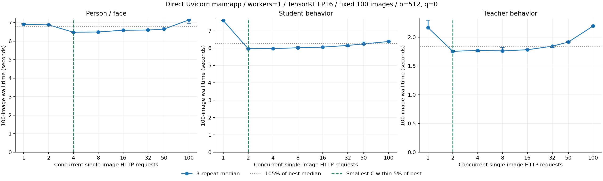
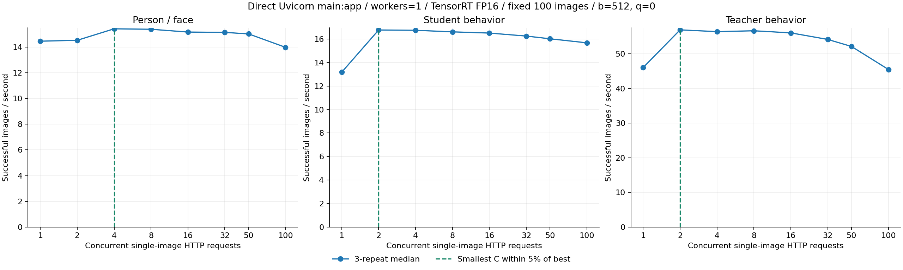
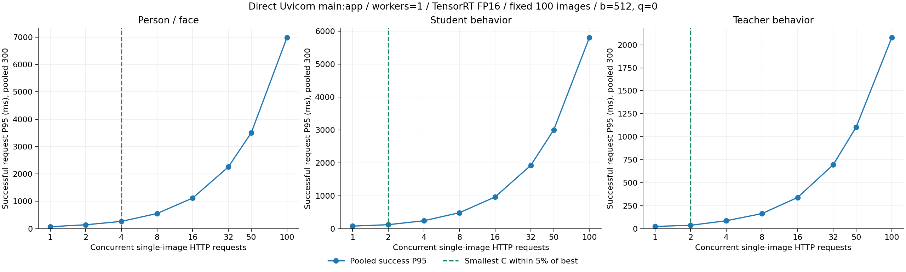

# 完整Uvicorn单worker：固定100图处理耗时与并发拐点

> 2026-11-23适用性补充：本报告为原编排版本人数性能、时延及路数的历史记录。SyncTasks2现行TRT全面复测见[新任务](../../../20261123-synctasks2-trt-revalidation/README.md)；原始数据和历史结论保留，本文学生/教师性能没有因人数复测而重新验证。

72组/7200正式请求执行完成：成功7200，失败0。完整后端main:app只启动一次，--workers 1，三个接口分别测试，结束后服务已关闭。

## 条件及口径

服务器服务代码3f77bfdcb197fd7bb957e45104342389ed3daca7；指定物理GPU1 RTX3090，FP16项目四Engine、ImageSize640。沿用b512/q0，旧人数路由不经过批次准入。未修改服务/模型/阈值，关闭外部注册，仅loopback18985，不部署。

每接口固定100个不同图片ID，一请求一图；每档C1/2/4/8/16/32/50/100重复3轮，同接口图片/顺序/字节完全一致，seed20261118。第一轮升序、第二轮降序、第三轮固定乱序；每接口预热30秒，组间空闲2秒。模型加载/预热/客户端进程启动及输入预载不计入100图耗时；新客户端HTTP连接建立计入。统计从首个正式发送任务启动到最后body接收，包含并发填充和排空，无重试、timeout60。

三轮均100成功才将100/中位秒数称有效图/s。P95合并该点三轮300个成功请求重算，不平均各轮P95；耗时范围是三轮最小～最大，不是置信区间。平台候选按测前规则：中位耗时距离全网格最优不超过5%的最小C；5%不是生产SLO或精确因果阈值。

## 每个接口100张需要多久

| 接口 | 平台候选C | 三轮中位秒 | 网格最快C | 最快中位秒 |
|---|---:|---:|---:|---:|
| 人数/人脸 | 4 | 6.483 | 4 | 6.483 |
| 学生行为 | 2 | 5.964 | 2 | 5.964 |
| 教师行为 | 2 | 1.756 | 2 | 1.756 |

## 全部24个档位（每点三轮各100张）

| 接口 | C | 三轮秒数（升序轮/降序轮/乱序轮） | 中位秒 | 最小～最大秒 | 成功/300 | 失败 | 100/中位秒 | 合并成功P95毫秒 | 发生器CPU%单核 |
|---|---:|---|---:|---|---:|---:|---:|---:|---:|
| 人数/人脸 | 1 | 6.885/6.951/6.914 | 6.914 | 6.885～6.951 | 300 | 0 | 14.46 | 72.11 | 7.11 |
| 人数/人脸 | 2 | 6.823/6.882/6.903 | 6.882 | 6.823～6.903 | 300 | 0 | 14.53 | 144.02 | 6.67 |
| 人数/人脸 | 4 | 6.470/6.483/6.488 | 6.483 | 6.470～6.488 | 300 | 0 | 15.42 | 267.34 | 7.50 |
| 人数/人脸 | 8 | 6.479/6.498/6.498 | 6.498 | 6.479～6.498 | 300 | 0 | 15.39 | 555.38 | 7.92 |
| 人数/人脸 | 16 | 6.557/6.591/6.591 | 6.591 | 6.557～6.591 | 300 | 0 | 15.17 | 1119.73 | 8.04 |
| 人数/人脸 | 32 | 6.573/6.602/6.615 | 6.602 | 6.573～6.615 | 300 | 0 | 15.15 | 2256.14 | 8.93 |
| 人数/人脸 | 50 | 6.641/6.654/6.717 | 6.654 | 6.641～6.717 | 300 | 0 | 15.03 | 3505.19 | 10.83 |
| 人数/人脸 | 100 | 6.966/7.150/7.179 | 7.150 | 6.966～7.179 | 300 | 0 | 13.99 | 6981.20 | 8.16 |
| 学生行为 | 1 | 7.590/7.590/7.612 | 7.590 | 7.590～7.612 | 300 | 0 | 13.17 | 78.86 | 6.53 |
| 学生行为 | 2 | 5.935/5.979/5.964 | 5.964 | 5.935～5.979 | 300 | 0 | 16.77 | 122.07 | 9.78 |
| 学生行为 | 4 | 6.004/5.972/5.967 | 5.972 | 5.967～6.004 | 300 | 0 | 16.74 | 242.15 | 9.76 |
| 学生行为 | 8 | 6.085/6.020/5.979 | 6.020 | 5.979～6.085 | 300 | 0 | 16.61 | 486.74 | 9.69 |
| 学生行为 | 16 | 6.075/6.054/6.058 | 6.058 | 6.054～6.075 | 300 | 0 | 16.51 | 965.25 | 10.06 |
| 学生行为 | 32 | 6.153/6.183/6.093 | 6.153 | 6.093～6.183 | 300 | 0 | 16.25 | 1924.86 | 10.11 |
| 学生行为 | 50 | 6.203/6.242/6.349 | 6.242 | 6.203～6.349 | 300 | 0 | 16.02 | 3001.64 | 9.88 |
| 学生行为 | 100 | 6.380/6.465/6.368 | 6.380 | 6.368～6.465 | 300 | 0 | 15.68 | 5807.17 | 11.48 |
| 教师行为 | 1 | 2.170/2.297/2.167 | 2.170 | 2.167～2.297 | 300 | 0 | 46.07 | 24.76 | 20.42 |
| 教师行为 | 2 | 1.752/1.773/1.756 | 1.756 | 1.752～1.773 | 300 | 0 | 56.94 | 37.11 | 25.96 |
| 教师行为 | 4 | 1.750/1.776/1.772 | 1.772 | 1.750～1.776 | 300 | 0 | 56.43 | 86.79 | 25.63 |
| 教师行为 | 8 | 1.748/1.827/1.764 | 1.764 | 1.748～1.827 | 300 | 0 | 56.67 | 164.28 | 25.72 |
| 教师行为 | 16 | 1.784/1.778/1.791 | 1.784 | 1.778～1.791 | 300 | 0 | 56.07 | 339.96 | 26.72 |
| 教师行为 | 32 | 1.846/1.847/1.827 | 1.846 | 1.827～1.847 | 300 | 0 | 54.18 | 695.82 | 30.61 |
| 教师行为 | 50 | 1.926/1.918/1.912 | 1.918 | 1.912～1.926 | 300 | 0 | 52.15 | 1105.53 | 31.37 |
| 教师行为 | 100 | 2.190/2.197/2.205 | 2.197 | 2.190～2.205 | 300 | 0 | 45.51 | 2079.91 | 26.20 |

## 解释与限制

- 人数/人脸：C1中位6.914秒，平台候选C4中位6.483秒，固定100图加速1.067倍。此候选是当前网格/工作集的有限结论；最优与候选区别在于允许5%内的小幅时间差。
- 学生行为：C1中位7.590秒，平台候选C2中位5.964秒，固定100图加速1.273倍。此候选是当前网格/工作集的有限结论；最优与候选区别在于允许5%内的小幅时间差。
- 教师行为：C1中位2.170秒，平台候选C2中位1.756秒，固定100图加速1.236倍。此候选是当前网格/工作集的有限结论；最优与候选区别在于允许5%内的小幅时间差。

固定100图包含填充/排空，不能与此前180秒稳态吞吐直接拼接。三轮很少、CPU非独占、只覆盖性能子集，无精度标注或生产延迟SLO，不作真实准确率、长期稳定性或服务硬峰值验收。若相邻档差异很小，按实际三轮范围看待，不能把微小波动解释为确定收益；最优在边界时也不能外推网格外。

一个worker是一个服务进程，不等于一个CPU线程；学生接口可并行使用多个模型线程。管理脚本、服务进程、发生器三个角色均有资源记录；短组1秒采样可能仅少量样本，原始摘要逐组列明样本数，同时保存发生器measurement process_time和服务/管理/proc CPU ticks起止。RSS峰值含客户端输入预载，不冒充仅正式推理内存。本轮不追认旧任务缺失的管理资源。

## 曲线

图中耗时误差线是三轮最小/最大；绿色线为5%平台候选，并非生产验收线。

## 证据与退出

原始run_id：uvicorn-fixed100-20261123-r1。完整包uvicorn-fixed100-checkpoint-20261123-r1/evidence.tar.gz：612文件、84587008字节、SHA256 `84e71ec06ae175199bbfe763fc7c5df0b5f4b08d76b258ee262b7a260219b02e`，源前后不变；本机整包/所有成员/解包逐文件核验通过。本机根/Users/zhangshen/.codex/backups/vbas-benchmark-20261118，服务器私有根/home/zhangs/workspace/vbas-benchmarks。包内有300个输入payload/ID哈希、72组完整响应及汇总、源配置/运行副本、模型指纹、命令/main进程PID、运行OpenAPI、Health/WorkerStatus、服务/控制日志、角色资源采样、代码bundle及依赖。四Engine本体沿用此前模型交接包，开始/结束按manifest SHA验证，不重建或改写。

原始逐条重算100序号/ID/成功数/分位数和makespan全部一致，汇总SHA `976bdd1cebdc47234318feecb9d931c7693f2c5a4282679f7086fa57d71a6c98`。复算工具report_fixed100.py和制图工具plot_fixed100.py随报告提供；请求与完整私有配置不入Git。

退出核对：{"server_pid": 1702522, "server_returncode": -15, "port_closed": true, "gpu": "3 MiB, 13 %", "unix": 1795401324.0203345}。所有本任务客户端退出，后端端口关闭、指定GPU回到3MiB/0%，仅关闭本任务启动的服务，不停止其他服务、不删除旧环境/备份，不上线、不归档聊天。

## 收尾异常及独立复核

网络在最后阶段中断，63组检查点是当时最后可读进度，现已恢复并读取全部72组原件，历史检查点保留。控制脚本完成全部72组后，在finally中关闭Uvicorn；server.log明确Application shutdown complete/Finished server process。cleanup.json记录server PID1702522已退出、port_closed=true，但关闭瞬间GPU为3MiB/13%，因此脚本最后以断言错误退出，并非72组HTTP/业务失败。原始日志及13%记录没有改写。恢复连接后独立核对该PID不存在、18985端口关闭，三次GPU读数均3MiB/0%，post-cleanup-recheck.json随完整包保存。未重新启动服务或重复任何测量组。

/proc CPU边界记录括住客户端子进程生命周期，包含客户端启动/输入预载/结果保存，不能直接除以正式makespan冒充正式CPU均值；正式窗口采样及发生器process_time另行记录。图片输入固定Base64，主结果不包含下载/磁盘读取耗时。

制图采用r2，三PNG均经视觉检查、三SVG经XML解析；r1仅因制图工具对__file__字符串计算SHA时类型错误未生成清单，原图候选保留，测量数据未变。

派生工具/汇总/图表/QA完整包：uvicorn-fixed100-artifacts-checkpoint-20261123-r1，22文件/717822字节，SHA256 `0c2630c237e8d57566aec0414941b5baa83f5bf086dd0db3cc1d15520cd13c7c`，源前后不变，本机及服务器整包/成员/解包核验。报告采用r2图表。服务/管理/proc ticks边界括住客户端子进程生命周期，包含客户端启动/输入预载/结果保存，不能将边界差值等同正式makespan内的纯CPU开销；正式采样按逐组绝对起止筛选，样本数1～7。
