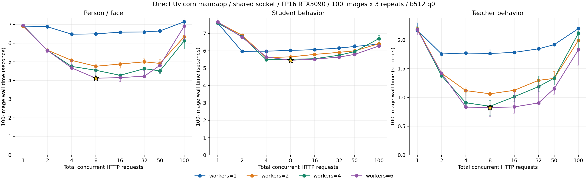
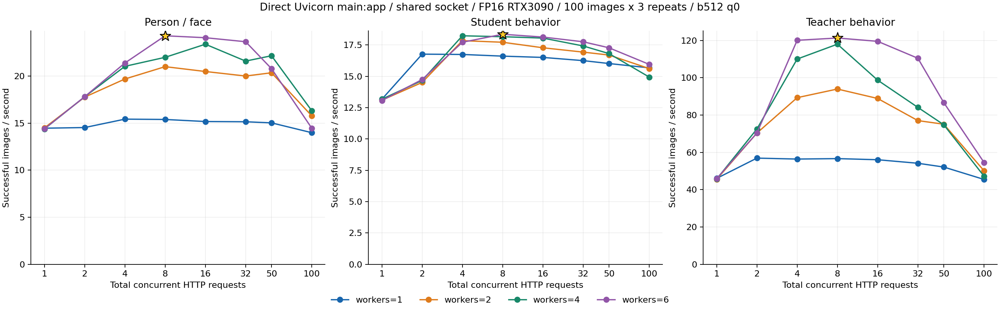
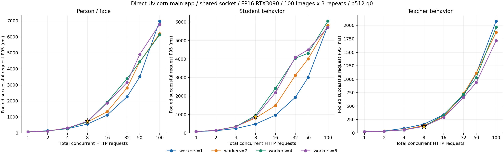

# Uvicorn workers与并发：固定100图效率报告

状态：W2/4/6共216组、21600正式请求完成，成功21600、失败0。另引用已完成W1的72组7200请求，未重跑旧基线。每阶段服务均已关闭。

## 逐接口最快组合

| 接口 | 最快W/C | 100图中位秒 | 三轮范围秒 | 对旧W1最佳加速 | 5%内低资源W/C |
|---|---|---:|---|---:|---|
| 人数/人脸 | 6/8 | 4.119 | 4.082～4.777 | 1.574倍 | 4/16（4.276秒） |
| 学生行为 | 6/8 | 5.448 | 5.431～5.517 | 1.095倍 | 2/4（5.604秒） |
| 教师行为 | 6/8 | 0.824 | 0.668～0.891 | 2.131倍 | 4/8（0.847秒） |

## 同一后端统一workers的建议

按三个接口各处理100张、等量顺序任务的指标，统一选择workers=6，各接口并发为{"sync": 8, "student": 8, "teacher": 8}，三个独立中位耗时之和10.391秒。该和是分别测量中位数之和，不是直接测得的混合并发300图耗时；业务占比变化时，不保证仍最优。

| 统一W | 三接口各100图中位之和秒 | 各接口并发（人数/学生/教师） |
|---|---:|---|
| 1 | 14.203 | 4/2/2 |
| 2 | 11.430 | 8/4/8 |
| 4 | 10.608 | 16/4/8 |
| 6 | 10.391 | 8/8/8 |

W4的等量合计10.608秒，比W6慢0.217秒（约2.09%），阶段显存峰值6449MiB，W6为9671MiB（多3222MiB）。这是资源取舍：若只追求本次最短耗时，选择W6/C8；不能把这2.09%解释为有统计显著性的稳定差异。

## 每W的并发平台（最小C距该W最快耗时不超过5%）

| 接口 | W | 平台C | 平台100图秒 | 该W最快C | 最快秒 |
|---|---:|---:|---:|---:|---:|
| 人数/人脸 | 1 | 4 | 6.483 | 4 | 6.483 |
| 人数/人脸 | 2 | 8 | 4.762 | 8 | 4.762 |
| 人数/人脸 | 4 | 16 | 4.276 | 16 | 4.276 |
| 人数/人脸 | 6 | 8 | 4.119 | 8 | 4.119 |
| 学生行为 | 1 | 2 | 5.964 | 2 | 5.964 |
| 学生行为 | 2 | 4 | 5.604 | 4 | 5.604 |
| 学生行为 | 4 | 4 | 5.484 | 4 | 5.484 |
| 学生行为 | 6 | 4 | 5.644 | 8 | 5.448 |
| 教师行为 | 1 | 2 | 1.756 | 2 | 1.756 |
| 教师行为 | 2 | 8 | 1.064 | 8 | 1.064 |
| 教师行为 | 4 | 8 | 0.847 | 8 | 0.847 |
| 教师行为 | 6 | 4 | 0.833 | 8 | 0.824 |

对W6，人数在C8附近进入平台；学生C4已距最快耗时5%内，C8中位最快；教师C4～16接近平台，C8最快。继续提高至C50/100未得到更短耗时，C100明显退化。共享socket和keepalive造成的worker分配偏斜会影响这一曲线，不能只据并发数字判断GPU硬饱和。

## 全部96个档位（每档3轮，每轮100张）

| 接口 | W | C | 三轮秒数 | 中位秒 | 成功/300 | 失败 | 有效图/s | 合并成功P95毫秒 | 发生器CPU%单核 |
|---|---:|---:|---|---:|---:|---:|---:|---:|---:|
| 人数/人脸 | 1 | 1 | 6.885/6.951/6.914 | 6.914 | 300 | 0 | 14.46 | 72.11 | 7.11 |
| 人数/人脸 | 1 | 2 | 6.823/6.882/6.903 | 6.882 | 300 | 0 | 14.53 | 144.02 | 6.67 |
| 人数/人脸 | 1 | 4 | 6.470/6.483/6.488 | 6.483 | 300 | 0 | 15.42 | 267.34 | 7.50 |
| 人数/人脸 | 1 | 8 | 6.479/6.498/6.498 | 6.498 | 300 | 0 | 15.39 | 555.38 | 7.92 |
| 人数/人脸 | 1 | 16 | 6.557/6.591/6.591 | 6.591 | 300 | 0 | 15.17 | 1119.73 | 8.04 |
| 人数/人脸 | 1 | 32 | 6.573/6.602/6.615 | 6.602 | 300 | 0 | 15.15 | 2256.14 | 8.93 |
| 人数/人脸 | 1 | 50 | 6.641/6.654/6.717 | 6.654 | 300 | 0 | 15.03 | 3505.19 | 10.83 |
| 人数/人脸 | 1 | 100 | 6.966/7.150/7.179 | 7.150 | 300 | 0 | 13.99 | 6981.20 | 8.16 |
| 人数/人脸 | 2 | 1 | 6.873/6.899/6.956 | 6.899 | 300 | 0 | 14.49 | 72.45 | 6.97 |
| 人数/人脸 | 2 | 2 | 5.568/5.629/5.660 | 5.629 | 300 | 0 | 17.77 | 119.10 | 8.41 |
| 人数/人脸 | 2 | 4 | 5.075/5.079/5.193 | 5.079 | 300 | 0 | 19.69 | 318.76 | 9.59 |
| 人数/人脸 | 2 | 8 | 4.730/4.862/4.762 | 4.762 | 300 | 0 | 21.00 | 680.88 | 11.32 |
| 人数/人脸 | 2 | 16 | 4.654/4.881/4.900 | 4.881 | 300 | 0 | 20.49 | 1330.44 | 10.95 |
| 人数/人脸 | 2 | 32 | 4.934/5.157/4.999 | 4.999 | 300 | 0 | 20.00 | 2811.83 | 11.46 |
| 人数/人脸 | 2 | 50 | 4.876/4.914/5.107 | 4.914 | 300 | 0 | 20.35 | 4439.85 | 10.87 |
| 人数/人脸 | 2 | 100 | 6.194/6.373/6.339 | 6.339 | 300 | 0 | 15.78 | 6194.36 | 9.72 |
| 人数/人脸 | 4 | 1 | 6.965/6.942/6.952 | 6.952 | 300 | 0 | 14.38 | 72.68 | 7.17 |
| 人数/人脸 | 4 | 2 | 5.594/5.618/5.617 | 5.617 | 300 | 0 | 17.80 | 119.43 | 8.23 |
| 人数/人脸 | 4 | 4 | 4.556/4.868/4.754 | 4.754 | 300 | 0 | 21.04 | 295.14 | 9.95 |
| 人数/人脸 | 4 | 8 | 4.547/4.129/4.662 | 4.547 | 300 | 0 | 21.99 | 690.16 | 11.89 |
| 人数/人脸 | 4 | 16 | 4.159/4.358/4.276 | 4.276 | 300 | 0 | 23.38 | 1918.36 | 12.09 |
| 人数/人脸 | 4 | 32 | 4.295/4.673/4.631 | 4.631 | 300 | 0 | 21.59 | 3394.29 | 12.13 |
| 人数/人脸 | 4 | 50 | 4.382/4.513/4.562 | 4.513 | 300 | 0 | 22.16 | 4438.06 | 12.64 |
| 人数/人脸 | 4 | 100 | 6.128/5.692/6.328 | 6.128 | 300 | 0 | 16.32 | 6130.80 | 10.00 |
| 人数/人脸 | 6 | 1 | 6.949/6.975/6.942 | 6.949 | 300 | 0 | 14.39 | 72.55 | 7.06 |
| 人数/人脸 | 6 | 2 | 5.616/5.505/5.617 | 5.616 | 300 | 0 | 17.81 | 118.58 | 8.33 |
| 人数/人脸 | 6 | 4 | 4.675/5.078/4.637 | 4.675 | 300 | 0 | 21.39 | 314.36 | 10.17 |
| 人数/人脸 | 6 | 8 | 4.777/4.119/4.082 | 4.119 | 300 | 0 | 24.28 | 730.99 | 12.64 |
| 人数/人脸 | 6 | 16 | 4.215/4.154/3.930 | 4.154 | 300 | 0 | 24.08 | 1864.86 | 12.69 |
| 人数/人脸 | 6 | 32 | 4.228/4.208/4.537 | 4.228 | 300 | 0 | 23.65 | 3154.27 | 12.49 |
| 人数/人脸 | 6 | 50 | 5.006/4.443/4.811 | 4.811 | 300 | 0 | 20.79 | 4911.29 | 11.12 |
| 人数/人脸 | 6 | 100 | 6.953/6.914/6.195 | 6.914 | 300 | 0 | 14.46 | 6783.47 | 8.88 |
| 学生行为 | 1 | 1 | 7.590/7.590/7.612 | 7.590 | 300 | 0 | 13.17 | 78.86 | 6.53 |
| 学生行为 | 1 | 2 | 5.935/5.979/5.964 | 5.964 | 300 | 0 | 16.77 | 122.07 | 9.78 |
| 学生行为 | 1 | 4 | 6.004/5.972/5.967 | 5.972 | 300 | 0 | 16.74 | 242.15 | 9.76 |
| 学生行为 | 1 | 8 | 6.085/6.020/5.979 | 6.020 | 300 | 0 | 16.61 | 486.74 | 9.69 |
| 学生行为 | 1 | 16 | 6.075/6.054/6.058 | 6.058 | 300 | 0 | 16.51 | 965.25 | 10.06 |
| 学生行为 | 1 | 32 | 6.153/6.183/6.093 | 6.153 | 300 | 0 | 16.25 | 1924.86 | 10.11 |
| 学生行为 | 1 | 50 | 6.203/6.242/6.349 | 6.242 | 300 | 0 | 16.02 | 3001.64 | 9.88 |
| 学生行为 | 1 | 100 | 6.380/6.465/6.368 | 6.380 | 300 | 0 | 15.68 | 5807.17 | 11.48 |
| 学生行为 | 2 | 1 | 7.635/7.595/7.722 | 7.635 | 300 | 0 | 13.10 | 80.37 | 6.47 |
| 学生行为 | 2 | 2 | 6.893/6.891/6.858 | 6.891 | 300 | 0 | 14.51 | 145.37 | 6.93 |
| 学生行为 | 2 | 4 | 5.665/5.604/5.552 | 5.604 | 300 | 0 | 17.85 | 352.20 | 9.70 |
| 学生行为 | 2 | 8 | 5.644/5.621/5.761 | 5.644 | 300 | 0 | 17.72 | 813.20 | 10.07 |
| 学生行为 | 2 | 16 | 5.788/5.748/5.801 | 5.788 | 300 | 0 | 17.28 | 1483.66 | 11.02 |
| 学生行为 | 2 | 32 | 5.937/5.906/5.864 | 5.906 | 300 | 0 | 16.93 | 3114.58 | 10.69 |
| 学生行为 | 2 | 50 | 5.967/6.037/5.989 | 5.989 | 300 | 0 | 16.70 | 4004.62 | 10.66 |
| 学生行为 | 2 | 100 | 6.403/6.424/6.258 | 6.403 | 300 | 0 | 15.62 | 5812.28 | 11.39 |
| 学生行为 | 4 | 1 | 7.756/7.589/7.573 | 7.589 | 300 | 0 | 13.18 | 79.95 | 6.30 |
| 学生行为 | 4 | 2 | 6.878/6.817/6.757 | 6.817 | 300 | 0 | 14.67 | 145.08 | 7.01 |
| 学生行为 | 4 | 4 | 5.505/5.484/5.476 | 5.484 | 300 | 0 | 18.23 | 343.28 | 9.68 |
| 学生行为 | 4 | 8 | 5.507/5.591/5.498 | 5.507 | 300 | 0 | 18.16 | 947.89 | 9.57 |
| 学生行为 | 4 | 16 | 5.540/5.588/5.503 | 5.540 | 300 | 0 | 18.05 | 2416.82 | 10.12 |
| 学生行为 | 4 | 32 | 5.788/5.722/5.739 | 5.739 | 300 | 0 | 17.42 | 4043.26 | 9.70 |
| 学生行为 | 4 | 50 | 5.896/5.948/5.954 | 5.948 | 300 | 0 | 16.81 | 4311.03 | 9.96 |
| 学生行为 | 4 | 100 | 6.290/6.694/6.882 | 6.694 | 300 | 0 | 14.94 | 6052.61 | 10.50 |
| 学生行为 | 6 | 1 | 7.650/7.585/7.673 | 7.650 | 300 | 0 | 13.07 | 80.34 | 6.43 |
| 学生行为 | 6 | 2 | 6.851/6.781/6.739 | 6.781 | 300 | 0 | 14.75 | 143.75 | 6.99 |
| 学生行为 | 6 | 4 | 6.053/5.644/5.530 | 5.644 | 300 | 0 | 17.72 | 335.87 | 9.24 |
| 学生行为 | 6 | 8 | 5.448/5.431/5.517 | 5.448 | 300 | 0 | 18.36 | 879.53 | 10.30 |
| 学生行为 | 6 | 16 | 5.491/5.515/5.565 | 5.515 | 300 | 0 | 18.13 | 2181.72 | 10.61 |
| 学生行为 | 6 | 32 | 5.704/5.619/5.632 | 5.632 | 300 | 0 | 17.76 | 4091.01 | 10.45 |
| 学生行为 | 6 | 50 | 5.794/5.789/5.782 | 5.789 | 300 | 0 | 17.28 | 4499.17 | 10.31 |
| 学生行为 | 6 | 100 | 6.301/6.179/6.269 | 6.269 | 300 | 0 | 15.95 | 5723.11 | 11.75 |
| 教师行为 | 1 | 1 | 2.170/2.297/2.167 | 2.170 | 300 | 0 | 46.07 | 24.76 | 20.42 |
| 教师行为 | 1 | 2 | 1.752/1.773/1.756 | 1.756 | 300 | 0 | 56.94 | 37.11 | 25.96 |
| 教师行为 | 1 | 4 | 1.750/1.776/1.772 | 1.772 | 300 | 0 | 56.43 | 86.79 | 25.63 |
| 教师行为 | 1 | 8 | 1.748/1.827/1.764 | 1.764 | 300 | 0 | 56.67 | 164.28 | 25.72 |
| 教师行为 | 1 | 16 | 1.784/1.778/1.791 | 1.784 | 300 | 0 | 56.07 | 339.96 | 26.72 |
| 教师行为 | 1 | 32 | 1.846/1.847/1.827 | 1.846 | 300 | 0 | 54.18 | 695.82 | 30.61 |
| 教师行为 | 1 | 50 | 1.926/1.918/1.912 | 1.918 | 300 | 0 | 52.15 | 1105.53 | 31.37 |
| 教师行为 | 1 | 100 | 2.190/2.197/2.205 | 2.197 | 300 | 0 | 45.51 | 2079.91 | 26.20 |
| 教师行为 | 2 | 1 | 2.204/2.194/2.193 | 2.194 | 300 | 0 | 45.58 | 24.68 | 20.53 |
| 教师行为 | 2 | 2 | 1.421/1.411/1.431 | 1.421 | 300 | 0 | 70.37 | 34.13 | 30.94 |
| 教师行为 | 2 | 4 | 1.168/1.039/1.119 | 1.119 | 300 | 0 | 89.34 | 61.26 | 43.07 |
| 教师行为 | 2 | 8 | 1.066/1.033/1.064 | 1.064 | 300 | 0 | 93.97 | 139.70 | 43.53 |
| 教师行为 | 2 | 16 | 1.077/1.132/1.125 | 1.125 | 300 | 0 | 88.91 | 302.01 | 43.71 |
| 教师行为 | 2 | 32 | 1.319/1.247/1.298 | 1.298 | 300 | 0 | 77.05 | 730.74 | 41.41 |
| 教师行为 | 2 | 50 | 1.453/1.331/1.301 | 1.331 | 300 | 0 | 75.11 | 1115.74 | 40.90 |
| 教师行为 | 2 | 100 | 1.984/1.994/2.000 | 1.994 | 300 | 0 | 50.16 | 1870.15 | 29.57 |
| 教师行为 | 4 | 1 | 2.169/2.228/2.187 | 2.187 | 300 | 0 | 45.73 | 24.54 | 19.96 |
| 教师行为 | 4 | 2 | 1.348/1.398/1.378 | 1.378 | 300 | 0 | 72.56 | 33.18 | 31.46 |
| 教师行为 | 4 | 4 | 1.094/0.864/0.909 | 0.909 | 300 | 0 | 110.04 | 56.96 | 46.96 |
| 教师行为 | 4 | 8 | 0.950/0.847/0.691 | 0.847 | 300 | 0 | 118.01 | 123.74 | 52.48 |
| 教师行为 | 4 | 16 | 1.032/1.013/0.924 | 1.013 | 300 | 0 | 98.73 | 331.21 | 47.58 |
| 教师行为 | 4 | 32 | 1.371/1.189/1.099 | 1.189 | 300 | 0 | 84.12 | 720.57 | 41.54 |
| 教师行为 | 4 | 50 | 1.337/1.348/1.213 | 1.337 | 300 | 0 | 74.81 | 1027.57 | 39.01 |
| 教师行为 | 4 | 100 | 2.150/2.116/1.828 | 2.116 | 300 | 0 | 47.26 | 1967.51 | 29.11 |
| 教师行为 | 6 | 1 | 2.175/2.085/2.191 | 2.175 | 300 | 0 | 45.97 | 24.09 | 20.28 |
| 教师行为 | 6 | 2 | 1.406/1.421/1.426 | 1.421 | 300 | 0 | 70.37 | 33.55 | 31.10 |
| 教师行为 | 6 | 4 | 0.830/1.122/0.833 | 0.833 | 300 | 0 | 120.09 | 58.49 | 47.73 |
| 教师行为 | 6 | 8 | 0.824/0.668/0.891 | 0.824 | 300 | 0 | 121.32 | 124.14 | 55.80 |
| 教师行为 | 6 | 16 | 1.113/0.726/0.837 | 0.837 | 300 | 0 | 119.54 | 289.77 | 52.51 |
| 教师行为 | 6 | 32 | 0.870/0.905/1.231 | 0.905 | 300 | 0 | 110.47 | 662.09 | 50.83 |
| 教师行为 | 6 | 50 | 1.199/1.055/1.154 | 1.154 | 300 | 0 | 86.68 | 938.79 | 44.51 |
| 教师行为 | 6 | 100 | 1.833/1.560/1.831 | 1.831 | 300 | 0 | 54.62 | 1715.60 | 33.18 |

## 阶段资源成本（含启动/预热/正式/空闲）

| W | GPU显存峰值MiB | 全worker RSS峰值MiB | 全worker CPU和均值（单核100%口径） |
|---|---:|---:|---:|
| 1 | 1611 | 2841 | 118.42% |
| 2 | 3226 | 5020 | 198.99% |
| 4 | 6449 | 9153 | 262.89% |
| 6 | 9671 | 12664 | 312.23% |

资源表统计阶段内所有worker均被采到的时间点，含启动/预热/组间空闲，不能当各正式100图窗口的资源均值；用于观察完整多worker装载与运行成本。管理、Uvicorn父、辅助、发生器角色的逐PID原件也保留。CPU和可超过100%，不是整机百分比。

## worker实际覆盖与分配

W2/4/6均在全部GPU worker加载、应用startup complete后开始预热；并发短连接预热逐PID验证全覆盖。正式使用共享监听套接字、HTTPX每组新客户端、max connections及keepalive=C，不人为固定到worker。C<W时仅部分worker接收请求是该方式的真实结果；C>=W也不能承诺均匀，以下为三轮正式请求中活跃worker数（每轮100请求），原件含每PID完整计数。

| 接口 | W | C | 三轮活跃worker数 | 单worker最大请求占比（三轮最大） |
|---|---:|---:|---|---:|
| 人数/人脸 | 2 | 1 | 1/1/1 | 100% |
| 人数/人脸 | 2 | 2 | 2/2/2 | 50% |
| 人数/人脸 | 2 | 4 | 2/2/2 | 51% |
| 人数/人脸 | 2 | 8 | 2/2/2 | 55% |
| 人数/人脸 | 2 | 16 | 2/2/2 | 55% |
| 人数/人脸 | 2 | 32 | 2/2/2 | 62% |
| 人数/人脸 | 2 | 50 | 2/2/2 | 54% |
| 人数/人脸 | 2 | 100 | 2/2/2 | 81% |
| 学生行为 | 2 | 1 | 1/1/1 | 100% |
| 学生行为 | 2 | 2 | 2/2/2 | 50% |
| 学生行为 | 2 | 4 | 2/2/2 | 55% |
| 学生行为 | 2 | 8 | 2/2/2 | 56% |
| 学生行为 | 2 | 16 | 2/2/2 | 54% |
| 学生行为 | 2 | 32 | 2/2/2 | 61% |
| 学生行为 | 2 | 50 | 2/2/2 | 69% |
| 学生行为 | 2 | 100 | 2/2/2 | 87% |
| 教师行为 | 2 | 1 | 1/1/1 | 100% |
| 教师行为 | 2 | 2 | 2/2/2 | 50% |
| 教师行为 | 2 | 4 | 2/2/2 | 61% |
| 教师行为 | 2 | 8 | 2/2/2 | 52% |
| 教师行为 | 2 | 16 | 2/2/2 | 54% |
| 教师行为 | 2 | 32 | 2/2/2 | 63% |
| 教师行为 | 2 | 50 | 2/2/2 | 60% |
| 教师行为 | 2 | 100 | 2/2/2 | 87% |
| 人数/人脸 | 4 | 1 | 1/1/1 | 100% |
| 人数/人脸 | 4 | 2 | 2/2/2 | 50% |
| 人数/人脸 | 4 | 4 | 3/4/3 | 36% |
| 人数/人脸 | 4 | 8 | 3/4/2 | 52% |
| 人数/人脸 | 4 | 16 | 4/3/4 | 37% |
| 人数/人脸 | 4 | 32 | 4/3/3 | 47% |
| 人数/人脸 | 4 | 50 | 4/3/3 | 43% |
| 人数/人脸 | 4 | 100 | 4/4/4 | 79% |
| 学生行为 | 4 | 1 | 1/1/1 | 100% |
| 学生行为 | 4 | 2 | 2/2/2 | 50% |
| 学生行为 | 4 | 4 | 3/3/3 | 40% |
| 学生行为 | 4 | 8 | 3/3/3 | 42% |
| 学生行为 | 4 | 16 | 4/4/4 | 39% |
| 学生行为 | 4 | 32 | 3/4/3 | 57% |
| 学生行为 | 4 | 50 | 3/3/2 | 65% |
| 学生行为 | 4 | 100 | 4/3/3 | 97% |
| 教师行为 | 4 | 1 | 1/1/1 | 100% |
| 教师行为 | 4 | 2 | 2/2/2 | 51% |
| 教师行为 | 4 | 4 | 2/3/3 | 58% |
| 教师行为 | 4 | 8 | 3/3/4 | 48% |
| 教师行为 | 4 | 16 | 3/3/3 | 53% |
| 教师行为 | 4 | 32 | 2/3/3 | 69% |
| 教师行为 | 4 | 50 | 3/3/3 | 63% |
| 教师行为 | 4 | 100 | 2/4/2 | 97% |
| 人数/人脸 | 6 | 1 | 1/1/1 | 100% |
| 人数/人脸 | 6 | 2 | 2/2/2 | 50% |
| 人数/人脸 | 6 | 4 | 3/2/3 | 51% |
| 人数/人脸 | 6 | 8 | 2/4/4 | 55% |
| 人数/人脸 | 6 | 16 | 4/4/5 | 34% |
| 人数/人脸 | 6 | 32 | 4/4/3 | 41% |
| 人数/人脸 | 6 | 50 | 5/3/4 | 46% |
| 人数/人脸 | 6 | 100 | 3/4/4 | 85% |
| 学生行为 | 6 | 1 | 1/1/1 | 100% |
| 学生行为 | 6 | 2 | 2/2/2 | 50% |
| 学生行为 | 6 | 4 | 4/2/2 | 53% |
| 学生行为 | 6 | 8 | 5/4/3 | 36% |
| 学生行为 | 6 | 16 | 5/4/3 | 40% |
| 学生行为 | 6 | 32 | 3/5/4 | 49% |
| 学生行为 | 6 | 50 | 4/3/4 | 49% |
| 学生行为 | 6 | 100 | 6/3/4 | 75% |
| 教师行为 | 6 | 1 | 1/1/1 | 100% |
| 教师行为 | 6 | 2 | 2/2/2 | 50% |
| 教师行为 | 6 | 4 | 3/2/3 | 59% |
| 教师行为 | 6 | 8 | 4/5/3 | 45% |
| 教师行为 | 6 | 16 | 2/5/3 | 56% |
| 教师行为 | 6 | 32 | 5/4/2 | 61% |
| 教师行为 | 6 | 50 | 3/3/4 | 55% |
| 教师行为 | 6 | 100 | 4/3/4 | 77% |

## 曲线

星号是该接口全网格中位耗时最短点，耗时误差线是三轮最小/最大，不是置信区间。P95图的星号沿用最快100图耗时点，不表示该点P95最小。







## 口径与适用限制

服务代码冻结3f77bfd，物理GPU1 RTX3090、四个项目TensorRT FP16 Engine、教师ImageSize640；未修改模型/阈值/业务。单个Uvicorn main:app使用workers2/4/6，不是多个单worker实例。每worker b512/q0，旧人数接口不走批次准入；外部注册关闭，仅loopback18985，不部署。

完全复用旧W1每接口100个不同ID、相同payload SHA/顺序/seed20261118。客户端三阶段实际共读W2-r2的冻结输入副本，W4/W6另存相同字节备份，均与W1指纹核对；输入读取和JSON预载在计时前。每请求一图，C1/2/4/8/16/32/50/100三轮升序/降序/固定乱序，HTTP timeout60无重试。计时从正式首任务开始至最后body收到，含连接建立/并发填充/排空，不含模型装载、预热、输入预载、子进程启动。P95从每点300条成功请求合并重算，不平均各轮P95。三轮全100成功才推荐。

W2-r1只有单并发预热，458请求只落一个worker，预热覆盖守卫停止；两个模型worker已加载且最终清理成功，没有正式100图组。原件保留。正式r2改用至少30秒并发短连接预热C=max(8,4*W)，确认全部W后才测量。正式连接策略不变。W1旧预热C1；新阶段Uvicorn日志增加PID前缀，非同时间配对，未隔离预热/日志格式开销，微小差异不证明确定因果收益。

仅100图的短任务和三轮重复，不是长期稳态容量、真实准确率或生产验收。固定100工作集有限，CPU非独占，GPU/客户端/进程调度和共享socket分配共同影响墙钟耗时。最优在网格边界或差异落入三轮波动范围时，不外推更大W/C或硬峰值。5%是测前描述性平台规则，不是SLO或显著性标准。

管理、Uvicorn父、所有实际worker、辅助进程及发生器按角色采样CPU/RSS/GPU；短组1秒采样仅少量点，逐组CPU边界和发生器process_time及全部原始采样保留，不把含装载/预热的阶段峰值称正式资源均值。一个worker可有多个模型线程，不等于一个CPU核；阶段GPU显存最大值含启动/预热，仅描述装载成本。

## 证据与关闭

新阶段原始包uvicorn-workers-fixed100-checkpoint-20261123-r1/evidence.tar.gz：2160文件、329274584字节，SHA256 `e3cce039fbcbe45392d81f821a0643bfe4a649297c0ffaa2225014046aee703f`。源前后不变、本机整包/全部成员/解包核验通过。私有根：服务器/home/zhangs/workspace/vbas-benchmarks，本机/Users/zhangshen/.codex/backups/vbas-benchmark-20261118。包内含阶段输入/完整响应/实际PID/worker日志分配/资源/关闭及失败预热现场、代码bundle、配置/模型指纹与环境；完整私有配置/日志/照片不推Git。

旧W1原始包uvicorn-fixed100-checkpoint-20261123-r1，SHA84e71ec06ae175199bbfe763fc7c5df0b5f4b08d76b258ee262b7a260219b02e；复用W1汇总SHA `976bdd1cebdc47234318feecb9d931c7693f2c5a4282679f7086fa57d71a6c98`。四Engine本体沿用已校验模型交接包trt-migration-20261120-handoff-checkpoint-r1，SHA18435a887ff695a299633134f2a48752f480d574c7cbc85f21e8899e19a0317f，模型开始/结束指纹核对，不重建/替换。

本轮汇总SHA `e82df6a95a1f71fc32cfa9e0b4bd0d8fd97c58d32abbe0af7270cd3bd6bc5d1d`；离线逐条核对序号/ID/业务成功、分位数/makespan、预热及正式worker日志分配/计数通过。所有阶段端口关闭、真实worker全部退出、GPU连续三次3MiB/0%后才开下一阶段，最终无本任务后台服务；不关闭其他服务、不升级环境、不归档聊天。

最终采用本机uvicorn-workers-analysis-local-20261123-r3与服务器uvicorn-workers-analysis-portable-20261123-r2；summary及metrics.csv逐字节相同。首次跨Python3.11/3.12归集仅发生器CPU比例出现1 ULP浮点求和差异，旧归集原件保留；math.fsum用于新派生目录重算，计数/耗时/延迟/推荐不变，没有GPU重跑。

最终派生包uvicorn-workers-artifacts-checkpoint-20261123-r1/evidence.tar.gz：22文件、736515字节，SHA256 `62861111a4d693a5554f91e59a8be23947c29476c9917b048c79755dfc335e84`。包含最终本机/服务器归集副本、PNG/SVG/依赖/清单、QA、最终只读进程审计及私有执行/归集脚本；本机与服务器均整包/全部成员核验。原始包里的旧归集保持不变，最终推荐以本节指定summary为准。公开qa.json省略进程列表，完整审计在私有派生包。

最终只读复核：所有记录父/worker退出，18985关闭，无本任务服务/发生器遗留，指定GPU3MiB/0%，服务器HEAD 3f77bfdcb197fd7bb957e45104342389ed3daca7且工作区干净。各阶段清理完整记录含GPU初读残留利用率及随后连续三次空闲，不把首次残值误认为仍有任务进程。

## 启动与停止复核

私有配置保持TensorRT/FP16、指定GPU、b512/q0及关闭外部注册，运行命令模板：

```bash
CONFIG_PATH=/私有配置.toml CUDA_VISIBLE_DEVICES=GPU-8c6b7efd-2b4f-04f3-db71-b50d2482fc49 /home/zhangs/.conda/envs/vbas-trt/bin/python -m uvicorn main:app --host 127.0.0.1 --port 18985 --workers <W> --log-config /私有logging.json
```

停止仅对本任务记录且经实际命令/启动时间确认的Uvicorn父进程发送SIGTERM，由父进程回收worker；必要时只回收本任务新建进程组。之后检查所有实际worker PID退出、18985端口关闭、指定GPU连续三次3MiB/0%。不要对报告历史PID盲发信号。
